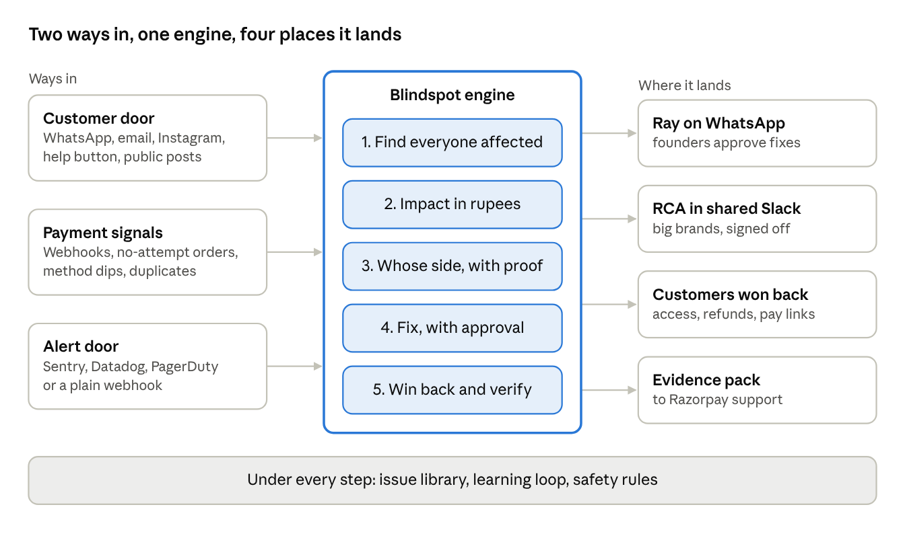
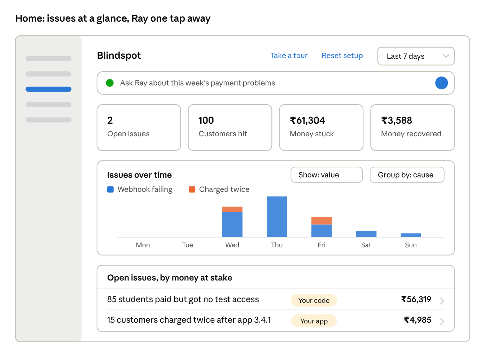
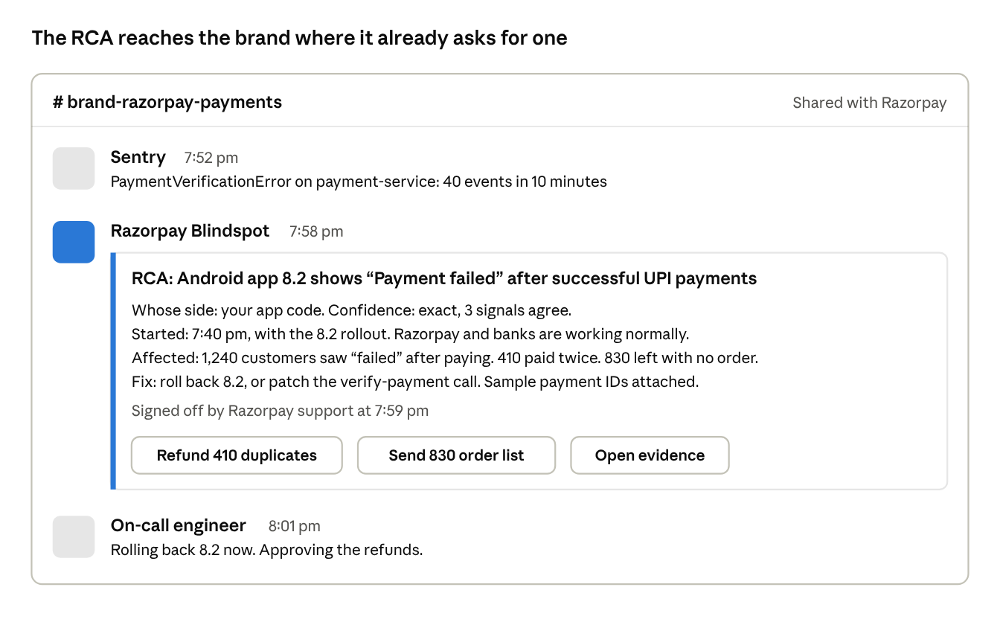
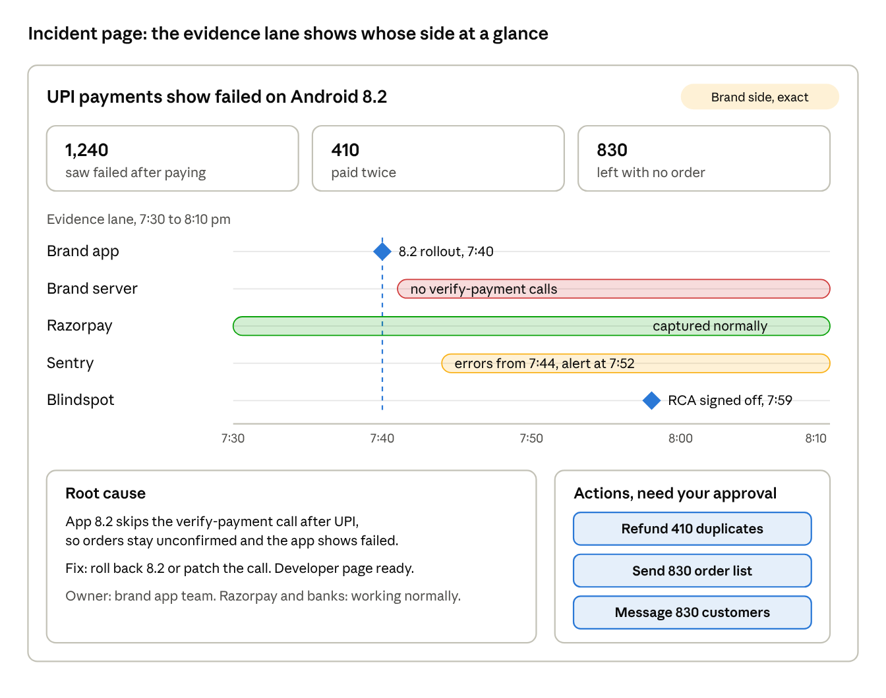
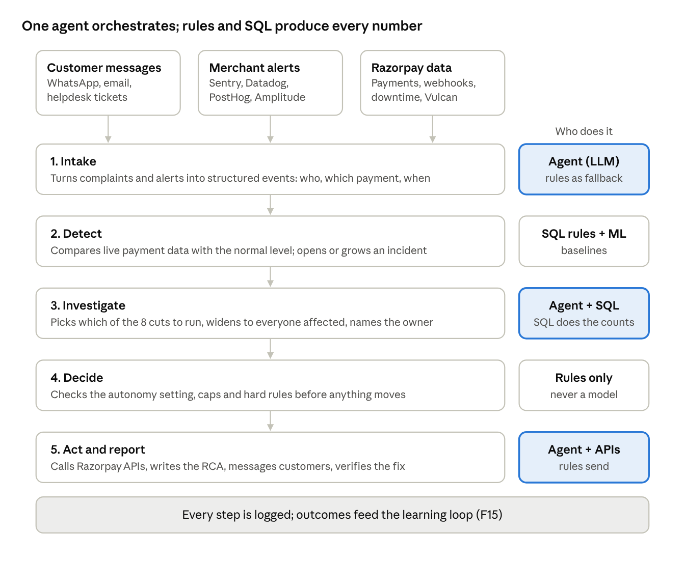
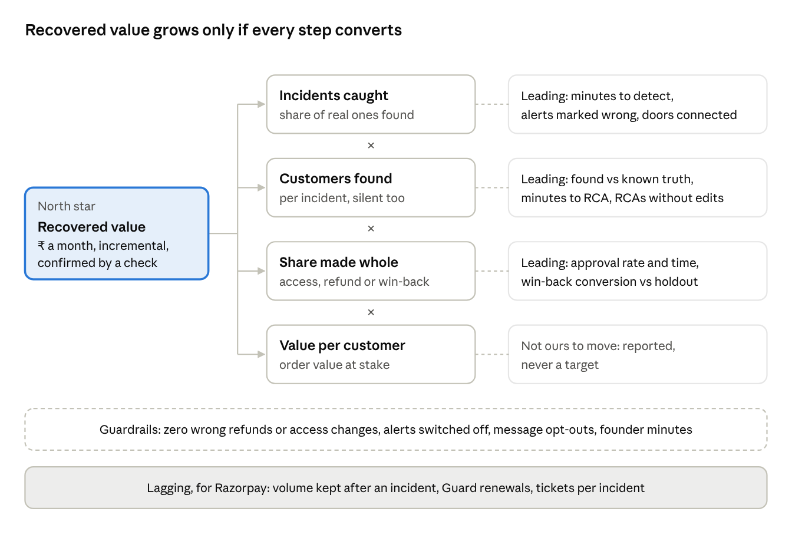
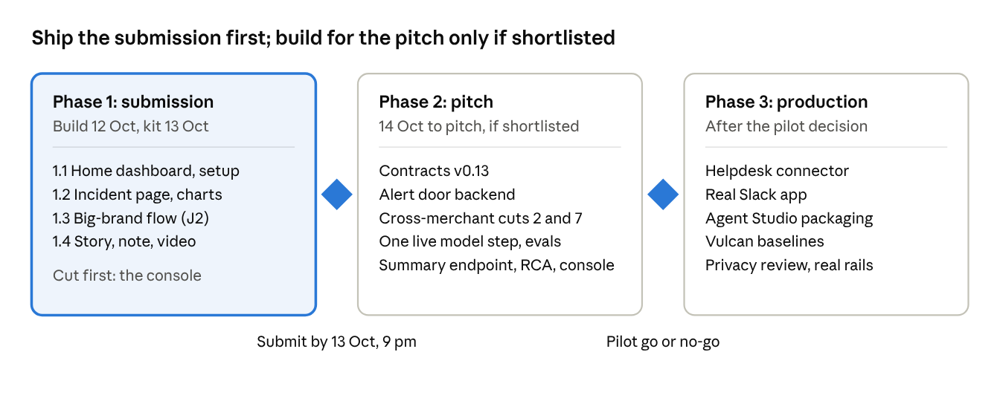

# Resolve PRD v3

> **Source of truth:** the PRD v3 Claude Doc (https://claude.ai/code/artifact/31e2f39b-bdfc-43ff-a448-4e41d74e7432), where Eshan comments. This file is an export of it on 12 Oct 2026 so coding sessions can read it. Change the doc first, then re-export here. Where this file and `docs/PRD.md` (v2) disagree, this file wins; v2 still applies where v3 is silent. Build order: `docs/ROADMAP_V3.md`.

Eshan Jain · exported 12 Oct 2026

Resolve is the payment gateway's support engineer for every merchant: it hears about a payment problem from customers or from the merchant's own alerts, finds everyone it hit, says whose side it is with proof, and fixes and wins customers back with the merchant's approval.

## 1. The problem and what we are building

**Problem:** When a payment breaks around the gateway, the merchant loses the order and usually the customer, and nobody finds out fast enough to act. Most customers who fail once do not try again, and most never complain.

A payment can break in five places:

1. The customer cannot reach or load the pay page (merchant site, plugin or checkout script).
2. The customer's bank or UPI app declines or times out.
3. The gateway errors or slows down.
4. The payment succeeds, but the merchant's system never hears about it (webhook, callback or plugin failure), so no order or access.
5. The payment succeeds twice, or a refund or renewal goes wrong afterwards.

Small merchants learn about it from angry messages days later, or never. Big brands learn within minutes from their own alerts, but cannot see the bank and gateway side, so they wait for the gateway's support engineers to send a root cause (RCA) in a shared Slack channel.

**What we are building.** One engine with two ways in.

- **Customer door** (small and mid-size merchants): complaints on WhatsApp, email, Instagram and a help button, joined with Razorpay payment data and plugin data (Shopify, WooCommerce).
- **Alert door** (big brands): the brand's alerting tool (Sentry, Datadog, PagerDuty or a plain webhook) forwards payment-related failures to Razorpay.

Whichever door a problem comes through, the engine does the same five things: find everyone affected, including those who never complained; put a rupee number on it; say whose side it is, with evidence; fix what Razorpay can fix, with the merchant's approval; win back the customers who dropped.

**Is it just you?** Before naming whose side a problem is, Resolve checks where the failures concentrate (one app version, checkout step, bank, region or plugin version) and whether other merchants see the same thing. Only Razorpay can compare across merchants; a single merchant or Sentry cannot. A shared cause, such as a cloud or telecom outage, means nobody wakes the merchant's developer for a bug that is not theirs.

**The lever we move.** Orders and revenue recovered, and time from first failure to a root cause. We do not claim to raise payment success rate: that is the share of attempts the bank approves, and Razorpay's routing products already own it.

**Why Razorpay wants it.** Every recovered order is volume Razorpay processes. A brand that gets a root cause in minutes has one less reason to shift traffic to its second gateway. For big brands, it turns support engineers' manual RCA hours into a product.

**What it is.** One agent in Agent Studio with two faces. Merchants meet it through RAY, the dashboard and Slack. Their customers meet it as "\[Merchant\] payment help, powered by Razorpay". The agent decides what to look at and which tools to call; the tools (SQL rules, statistical baselines, Razorpay's own APIs) produce every number and carry out every action. Agent Studio's current agents act inside the payment (recovery, mandates, disputes, cart). None hears from the merchant's customers, finds everyone a problem hit, or explains a failure across both sides.

**The pitch in one line.** Razorpay's agents help payments go through; Resolve handles the ones that broke around the gateway. It hears about the problem, finds everyone affected, says whose side it is using data only Razorpay has, and wins the customers back.

**Out of scope.** Fraud, routing, disputes, settlement explainers. Fixing a merchant's own website code. Anything that moves money or messages customers in bulk without the approval the merchant's autonomy setting requires (hard rule, SPEC section 0). Pay-again links to customers who dropped off are open: see section 14.

## 2. Customers we build for

We build for ten personas: six on the merchant side (the big-brand team is one persona with two roles), the payer, and three inside Razorpay. Three are primary for the demo: the small founder (customer door), the big-brand on-call engineer (alert door) and the Razorpay support engineer who signs off RCAs.

**How this matches the 5 Oct research.** The earlier set was six personas built from 289 merchant posts on Reddit and 120 complaints on X (out of 1,749 posts and 2,075 tweets collected). Four of those six were mostly simulated interviews on top of 5 to 12 real posts each, so treat them as hypotheses. Everything from that set carries over. The big-brand team is new and has the weakest evidence: no post or Razorpay transcript mentions shared Slack channels or RCAs.

| 5 Oct persona (research) | Real evidence behind it | Final persona | What changed |
| --- | --- | --- | --- |
| P1 Karan, solo or two-person SaaS founder | Webhook failed silently during a deploy, noticed only when a customer emailed; 60 of 90 international attempts failed | M1 Small founder | Widened from SaaS to any small merchant on a custom site |
| (none; D2C extension cut on 10 Oct) | Razorpay docs list "payment captured but not updated" as a known WooCommerce issue | M2 Plugin store owner (Shopify, WooCommerce) | New split; reverses part of a 10 Oct cut (section 14) |
| P2 Neha, subscription ops at a wellness app | Card renewals failing at 100% while UPI works; "RAY has no clue" about a failed subscription | M3 Mid-size ops lead | Kept; no post comes from someone at 100k-subscriber scale |
| P4 Neha, CX lead at a growing D2C brand | Agents cannot see Razorpay; finding the bank reference is the hard part | M4 Support lead | Kept as a user, not a buyer |
| P3 Karthik, freelance developer for 9 merchants | "Users were paying for orders, but the database wasn't reflecting them" | M5 Developer (freelance or in-house) | Kept |
| (new) | Eshan's previous company; the Flipkart developer conversation; Razorpay's CPO saying the largest customers get dedicated account managers | M6 Big-brand payments team: on-call engineer (user) and head of payments (buyer) | New. The weakest evidence in the set |
| P5 Ankit (Tier 2 UPI payer) and a metro card payer | Paid by QR, bank says credited, course says not received, complained to five parties | C1 Payer | Kept. Almost no Hinglish posts in the corpus |
| P6 Arjun, Razorpay account manager | 32 of 37 @RazorpayCare replies ask the person to DM an ID | R1 Razorpay support engineer and account manager | Widened to the engineer who writes RCAs |
| P6 Kavya, Razorpay grievance lead | Payers bounced between bank, merchant and Razorpay | R2 Razorpay grievance desk | Kept |
| (new) | Harshil Mathur: success rate is the core job; account managers come second | R3 Razorpay product owner (internal buyer) | New; funds it and owns the GMV case |

**Jobs, triggers and what success looks like**

| Persona | Job to be done | Trigger moment | What they do today | Success for them |
| --- | --- | --- | --- | --- |
| M1 Small founder | "Tell me what broke and who it hit, and fix it while I am busy" | Third angry DM in an hour, or a sales dip they cannot explain | Reads DMs one by one, checks the dashboard, emails Razorpay support | Every affected customer sorted in one pass, under an hour |
| M2 Plugin store owner | "Tell me if my checkout or plugin broke before I lose a day of sales" | A plugin or theme update; orders stop | Notices days later from sales; Googles the error | Knows within minutes; told whose side and what to click |
| M3 Mid-size ops lead | "Know how many customers and how much revenue a problem puts at risk, fast" | A renewal run fails; a churn spike | Spreadsheet from exports; asks the developer | Cohort size and rupees in the first message |
| M4 Support lead | "Find the payment behind a complaint without asking engineering" | A ticket says "money debited, no order" | Asks the customer for a screenshot, pings a developer | The payment found and the reply drafted |
| M5 Developer | "Get proof and the exact failing call, not a verdict" | Ops forwards an alert | Digs through logs and Razorpay's webhook settings | Sample IDs, the failing call and a suggested fix on one page |
| M6 Big-brand on-call engineer | "Tell me in minutes if it is us, Razorpay or the bank, with proof" | Sentry or Datadog fires on the payment service | Posts in the shared Slack channel and waits for the gateway's RCA | RCA in the channel before they ask |
| M6 Big-brand head of payments | "Keep checkout healthy across my gateways, and know which one explains failures fastest" | Weekly payments review; a bad day's revenue | Compares gateways' success rates; escalates through the account manager | Fewer lost orders; faster answers than the other gateway |
| C1 Payer | "Know within a minute whether I need to do anything" | Money debited, no order or access | Writes to the merchant, bank, Razorpay and X | A clear answer, then access or a refund |
| R1 Razorpay support engineer | "Spend my time on the hard cases, not on pulling logs" | A brand pings the shared channel | Pulls payment logs, downtime and webhook history by hand | Signs off a drafted RCA in minutes |
| R2 Grievance desk | "Get a case with the payment found and proof attached" | An escalation or a public complaint | Asks the person to DM an ID | Case arrives with IDs and owner |
| R3 Razorpay product owner | "Keep merchants' volume on Razorpay and cut support cost" | Churn to a second gateway; support load | Account managers and support teams | Recovered volume, lower RCA hours per account |

**How we reach them and what they let us do**

| Persona | Door | Where answers reach them | Autonomy they will likely give | Buys or uses | Priority |
| --- | --- | --- | --- | --- | --- |
| M1 Small founder | Customer door + payment signals | Ray on WhatsApp | Approve once, later Full automation | Buys and uses | Primary |
| M2 Plugin store owner | Customer door + plugin data | WhatsApp, email | Review first | Buys and uses | Secondary |
| M3 Mid-size ops lead | Customer door + payment signals | Dashboard, email | Review first | Buys and uses | Secondary |
| M4 Support lead | Customer door | Dashboard case view | n/a | Uses | Secondary |
| M5 Developer | Any | Developer page | n/a | Uses | Secondary |
| M6 Big-brand team | Alert door + payment signals | Shared Slack channel | Review first; Razorpay-side fixes only | Head of payments buys; engineer uses | Primary |
| C1 Payer | Contacts the merchant | WhatsApp, email, Instagram | n/a | Receives | Always present |
| R1 Support engineer | Console | Console, Slack | Signs off | Uses | Primary |
| R2 Grievance desk | Evidence pack | Internal queue | n/a | Uses | Tertiary |
| R3 Product owner | Reports | Monthly report | n/a | Funds | Tertiary |

**Who we do not build for.** Merchants where Razorpay carries a small share behind an orchestration layer such as Juspay, since we would see only our slice. Marketplaces whose main pain is settlements. Merchants whose main pain is fraud or chargebacks.

## 3. How big brands get answers today, and what replaces it

Big brands get root causes from people, in a shared Slack channel, hours after the alert. Resolve's alert door does the same investigation in minutes and posts the answer in that same channel. This loop comes from Eshan's previous company; whether Razorpay runs a shared channel for every large account is not verified.

**The loop today**

1. The brand's alert fires: payment API errors climb in Sentry, or checkout conversion drops on a dashboard.
2. The brand's engineer checks their own logs. They can see their side, not the bank or gateway side.
3. They post in the shared Slack channel: "Seeing UPI failures since 2:10 pm, can you check?"
4. A gateway support engineer pulls payment logs, bank downtime and the brand's API calls and webhook deliveries.
5. Back and forth: payment IDs, timestamps, screenshots, "can you share a request ID?"
6. An RCA arrives hours later, sometimes the next day. Whoever owns the fault fixes it.
7. The customers lost during the window are almost never contacted.

**Where it hurts**

| Pain | Today | With Resolve |
| --- | --- | --- |
| Time to first answer | Depends on who is online; hours | Minutes, any hour |
| Data gap | Brand sees its side, gateway sees its side, joined by hand | Joined automatically on payment ID, order ID and time |
| Blame | Both sides first check whether it is the other | Fault named with evidence and a confidence level |
| Scale | One support engineer covers many accounts | Every account gets the same depth |
| Lost customers | Not counted, not contacted | Counted in rupees, won back with approval |

**What replaces it.** The brand forwards payment-related alerts to Razorpay. Resolve joins them with Razorpay's payment data, writes the RCA, and posts it in the existing Slack channel (or email, or the dashboard). The support engineer stays in the channel and signs off anything Resolve marks as unsure.

**What it will not do.** It does not replace the account manager or the human relationship. It does not change anything in the brand's own systems. An RCA below the confidence bar goes out as a draft for the support engineer, not to the brand.

## 4. At a glance

Every problem runs through the same five steps, whichever way it came in. The founder and the big brand differ only in the door and in where the answer lands.

## 5. Features, in build order

Twenty-one features (F1a and F7a included), in the order a problem flows through the product. Each lists who it is for, whether it exists today (Built, Partial, New), its sub-features, how each works, and what it will not do.

### F1. Setup in three visible steps

For: everyone. Today: Partial (setup exists, steps hidden behind a button).

| Sub-feature | How it works | Will not |
| --- | --- | --- |
| Setup card on Overview | The three steps are listed on the card, each with a tick and its own button on the right. | Hide the steps behind one "Start setup" button. |
| Two setup paths | First question: "How do you find out about payment problems today?" Customers tell us, or our monitoring tells us. Founder path: channels, store, autonomy. Brand path: alerts, Slack, autonomy. | Lock a merchant into one path; both doors stay available. |
| Works on day one | Razorpay-side signals (F2) run with nothing connected. | Block the dashboard until setup is finished. |
| Reset setup | A "Reset setup" action in the setup page header, for demos and for re-onboarding. | Delete incidents or history. |

### F1a. Home: issues at a glance

For: everyone; built first for brands' ops and payments leads. Today: Partial (the Overview is chat-first with a "Right now" strip). Replaces the chat-first Overview, following Razorpay's own dashboard home (summary cards, a date range, then detail).

| Sub-feature | How it works | Will not |
| --- | --- | --- |
| Date range | A dropdown: Today, 7 days, 30 days, this month, custom. Everything on the page follows it. | Default to all time. |
| Four cards | Open issues, customers hit, money stuck, money recovered, each with the change against the previous period. | Show payment success rate; Razorpay's payment analytics already does. |
| One chart | Issues over the period. "Show" switches value or volume; "Group by" switches cause, whose side, payment method or region (the F7a cuts). | Become six fixed charts. Region appears only once cut 5 is verified. |
| Issue list | Open and recent issues sorted by money at stake; each row opens the incident. | Show closed issues by default. |
| Ask Ray | A slim input at the top; answers are about the selected period. | Be the hero of the page. |
| Setup card | Shown until setup is done, then folds into one line (F1). | Push issues below the fold once set up. |

### F2. Payment signals Razorpay already has

For: everyone, free. Today: Built for webhooks, duplicates and renewals; Partial for method dips.

| Sub-feature | How it works | Will not |
| --- | --- | --- |
| Webhook health | Flags failing deliveries, a disabled endpoint, and events whose retries ran out (Razorpay stops after about 24 hours). | Wait for the merchant to set an alert email. |
| Orders with no attempt | A jump in orders created with no payment attempt means customers cannot reach or load the pay page. | Alert on one or two stray orders; it needs a cluster above the merchant's baseline. |
| Method or bank dip | Success rate for one method, bank or app falls against the merchant's own baseline, checked against Razorpay downtime events. | Change routing or retry payments itself. |
| Paid but not served | Payment captured, but the merchant's system never confirmed the order or access. | Guess: it needs the plugin or an access check (F3, F4). |
| Duplicates and renewals | Two captures for one order; card or UPI AutoPay renewals failing in a cluster. | Refund or retry without approval. |

All numbers come from SQL rules on payments, orders and webhook logs, never from a model.

### F3. Customer door: hear the complaint

For: founders and mid-size brands. Today: Built (channels simulated in the prototype).

| Sub-feature | How it works | Will not |
| --- | --- | --- |
| WhatsApp payments number | A co-branded number, "\[Merchant\] payment help, powered by Razorpay", that says it is an AI assistant. | Pretend to be a person. |
| Email | A reply-to alias or a forwarding rule on keywords like "payment", "debited", "refund". | Read the rest of the merchant's inbox. |
| Instagram and Messenger | The merchant hands payment DMs over to Resolve. | Answer non-payment questions; those go back to the merchant. |
| Help button | A "Payment issue?" button on the order and checkout pages. | Replace the merchant's own support. |
| Public posts | A complaint on X or Instagram gets a generic public reply that moves the person to a private channel. | Link a public post to a payment, or say anything specific in public. |
| Find the payment | Asks for one identifier (order ID, UPI reference, phone or email) and matches it to the payment. Understands Hinglish. | Ask for an OTP, card number, UPI PIN or password. Ever. |
| Helpdesk tickets | Read-only connection to Freshdesk, Zendesk or Gorgias. Tickets about payment problems come in like any other complaint. Uses their open APIs; no partnership needed. The right door for mid-size and big brands, whose complaints already live in a helpdesk. | Reply inside the helpdesk or close tickets; the merchant's team keeps the ticket. |
| AI support bots (partnership) | Bots such as Nugget or Nurix call Resolve's payment lookup when a customer says money was debited; the case joins Resolve's incident. Needs a partner and Razorpay's MCP server. | Be built for the submission; it is a partnership pitch. |

### F4. Alert door: take in the brand's own alerts

For: big brands, and any merchant with monitoring. Today: New.

| Sub-feature | How it works | Will not |
| --- | --- | --- |
| Inbound endpoint | Each merchant gets a signed URL and secret to send alerts to. | Accept unsigned alerts. |
| Ready-made connections | Sentry (alert rule sends to a webhook), Datadog, PagerDuty, Grafana; anything else through the generic webhook. | Need a code change in the brand's app for the basic version. |
| Payment filter | The brand picks which projects, services or routes count as payment (checkout, pay, order confirm). Everything else is dropped. | Process the brand's unrelated errors. |
| Field mapping | Reads the time window, error type, endpoint, platform, app version and sample order or payment IDs. | Need customer names, phones or card data in the alert. |
| Grouping | 200 alerts in 10 minutes about one cause become one incident. | Post once per alert. |
| Funnel events (advanced) | The brand can also send checkout events (pay page loaded, pay tapped, SDK error) so a drop-off shows before their own alert fires. | Become an analytics product. |
| Match before acting | An alert is "unconfirmed" until it is matched to Razorpay payment data. | Act on an alert alone. |
| Product analytics | Amplitude or PostHog send checkout funnel alerts or events (cart, pay tapped, pay page loaded). They cover the steps before Razorpay's checkout, the "could not reach the pay page" zone. | Pull a brand's whole analytics; only checkout steps. |

### F5. Find everyone affected

For: everyone. Today: Built (in the webhook incident, 17 complaints widened to 85 affected customers; 68 never wrote in).

| Sub-feature | How it works | Will not |
| --- | --- | --- |
| Group into one incident | Complaints, alerts and signals with the same cause, time window and method, bank or plugin version become one incident. | Merge two causes to make one incident look bigger. |
| Widen to the silent | Queries every payment and order matching the incident's pattern to find customers who never complained. | Include customers outside the confirmed pattern. |
| Split by outcome | Paid but not served; failed and left; could not reach the page; charged twice. | Show one blended number. |
| Live count | The count updates while the incident is open. | Close itself while new matches still arrive. |

### F6. Impact in rupees

For: everyone; Razorpay sees the total. Today: Built.

| Sub-feature | How it works | Will not |
| --- | --- | --- |
| Three numbers | Money stuck (paid, not served), money lost (failed and left), money at risk (renewals due soon). | Estimate with a model. |
| Per incident and per month | Shown on the incident and in the monthly report (F16). | Count a won-back customer twice. |

### F7. Whose side, with proof (the RCA)

For: everyone; the core of the alert door. Today: Built as rules for six problem types; New as a written RCA.

| Sub-feature | How it works | Will not |
| --- | --- | --- |
| Fault owner | One of: merchant code, merchant settings, Razorpay, bank or UPI app, customer, unknown. | Pick an owner without evidence; "unknown" is an allowed answer. |
| Evidence lane | A timeline that lines up the brand's alert or deploy, Razorpay's payment events, webhook deliveries and bank downtime on one time axis. | Show evidence the merchant cannot open or check. |
| Confidence | Exact, likely or check, from how many signals agree. | Send a "likely" RCA to a big brand without a support engineer's sign-off. |
| Written RCA | What broke, when it started, how many it hit, whose side, the fix, how we will know it is fixed. Same format every time, posted where the merchant works (F12). | Use a model to produce the numbers; the model writes words around numbers from SQL. |
| Razorpay-side admission | When the fault is Razorpay's, it says so plainly and the fix is free (pricing rule D14). | Hide or soften a Razorpay fault. |
| Is it just you? | Runs the comparison check (F7a) before an owner is named. Three outcomes: only you; shared with many merchants (owner: network, provider or platform); unclear. | Blame the merchant for a shared outage, or name a shared cause without the cross-merchant count to back it. |

### F7a. The "Is it just you?" check

For: everyone; it feeds F7. Today: Partial. The backend already computes within-merchant concentration ("lift") for method, card network, error code, app version and response class; the incident page does not show it as this check yet. Cross-merchant cuts are new.

Resolve cuts the failures eight ways, in the same order every time, and asks where they concentrate. The RCA shows only the cut that explains the problem plus the ones that rule out the obvious alternatives, usually two or three lines.

| # | Cut | Question it answers | What it catches | Data it needs | Today |
| --- | --- | --- | --- | --- | --- |
| 1 | Payment method, bank, UPI app | Is one bank or app failing? | Bank or UPI app downtime | Razorpay payments | Built |
| 2 | Platform and app version | Is it one app release, browser or SDK version? | A bad release (J2) | Razorpay checkout SDK; the brand's app version from the alert door | New |
| 3 | Checkout step | Where do people stop: page load, method choice, OTP, bank page, or after paying? | Broken pay page vs bank vs callback | Razorpay checkout events; after payment, webhooks and verify calls | Partial |
| 4 | Amount and card type | Only high amounts, international cards or one card network? | UPI limits, card authentication limits, international card blocks | Razorpay payments | New |
| 5 | Payer region and network provider | Is it one state, city or mobile network? | Internet or telecom outage; OTP texts failing on one network | Payer IP or location at checkout. Not verified that Razorpay keeps it | New, verify first |
| 6 | Same plugin or SDK version, across merchants | Are other stores on this plugin version failing too? | A plugin release bug | Plugin version on API calls. Not verified | New |
| 7 | Same hosting provider, across merchants | Are webhooks failing for many merchants on the same cloud region? | Cloud or CDN outage vs your own deploy | Webhook addresses mapped to providers' published IP ranges | New |
| 8 | Same bank, app or region, across merchants | Is everyone seeing it? | A wide outage | Ecosystem Health already shows bank and method; region is new | Partial |

**Rules that keep it from overdoing it**

- A cut is shown only when failures concentrate in it: most failures sit in a slice that normally carries a small share of payments, above a minimum count. The thresholds start fixed and are tuned by the learning loop (F15).
- Each slice is compared with the same hour last week, not a flat average.
- Cross-merchant cuts (6 to 8) show counts across 5 or more merchants, never a name.
- Cuts we skip: merchant category (too broad to act on), customer demographics (privacy, and no fix follows), the merchant's office location (checkout runs in the cloud, not the office).

### F8. Issue library: known problem types and their playbooks

For: everyone; it is what makes answers fast. Today: Built for six types (paid no access, money left no payment, charged twice, refund not received, subscription out of sync, could not reach the page).

| Sub-feature | How it works | Will not |
| --- | --- | --- |
| One card per problem type | Each type has: how it is detected, the evidence needed, the usual owner, the fix, the customer message and how to verify. | Accept a problem type with no detection rule. |
| New types for the alert door | Checkout script fails to load; SDK or app version error; payment confirm API timing out; callback URL failing; plugin update broke checkout; method missing from checkout. | Cover fraud, chargebacks or settlement. |
| Built from evidence | New types come from the Reddit and X research, Razorpay docs and support patterns, and from the learning loop (F15). | Grow by guesswork. |
| Shared-cause types | Cloud or CDN outage; plugin release bug; internet or telecom outage in a region; one bank or UPI app down. Each comes from a cut in F7a. | Call a shared cause from one merchant's data alone. |

### F9. Fix, at the autonomy the merchant chose

For: everyone. Today: Built for webhook replay and access grant, duplicate refunds and renewal links.

| Sub-feature | How it works | Will not |
| --- | --- | --- |
| Autonomy setting | Three levels: Review first (default), Approve once, Full automation. Set per merchant, changeable any time. | Move money or message customers in bulk above what the level allows. |
| Razorpay-side fixes | Replay failed webhooks, grant access through the merchant's own access call, refund a duplicate to the original method, send a renewal or pay link through existing Razorpay products. | Rebuild retries or routing; it calls the products that already do this. |
| Staged runs | Dry run, then the first 5, then the rest, with a daily cap on refunds. | Run everything in one go. |
| Merchant-side fixes | A developer page with the cause, the exact failing call, sample IDs and a suggested code or settings change. | Edit the merchant's code, database or Razorpay settings. |
| Big-brand fixes | Razorpay-side mitigation where one exists, plus the RCA and sample IDs for the brand's on-call engineer. | Touch the brand's systems. |
| Never, at any level | Revoke a customer's access, refund to a different method, change Razorpay settings, write to the merchant's database. | Have a setting that unlocks these. |

### F10. Win back customers

For: everyone. Today: Built for incident messages and renewal links; pay-again links to drop-offs are cut (open decision, section 14).

| Sub-feature | How it works | Will not |
| --- | --- | --- |
| Reply to people who complained | A status reply in the channel they used, then a final "sorted" message when the fix lands. | Promise a time we cannot keep (no-false-urgency check). |
| Tell the silent ones | A short co-branded message to affected customers who never wrote in: what happened, what we did, whether they need to act. | Message customers outside the confirmed incident. |
| Pay again (if approved) | For customers who failed and left during the incident window: an apology and a pay link for the same order. | Spam: one message per customer per incident, and never to someone who already paid. |
| Preview first | The merchant sees every template and the recipient count before anything goes out. | Send bulk messages without the approval the autonomy level needs. |

### F11. Verify and close

For: everyone. Today: Built.

| Sub-feature | How it works | Will not |
| --- | --- | --- |
| Outcome check | After the fix, checks that the signal is healthy again (for webhooks, 24 healthy hours) and counts customers restored or won back. | Close on the fix alone. |
| Closing report | Before and after numbers, rupees recovered, time to RCA, what to change so it does not recur. | Claim recovery for customers who came back on their own before the fix. |

### F12. Where answers reach the merchant

For: everyone. Today: Built for Ray on WhatsApp (simulated) and the dashboard; New for Slack.

| Sub-feature | How it works | Will not |
| --- | --- | --- |
| Ray on WhatsApp | Founders get the alert, the RCA and approve buttons on WhatsApp. | Ask for approval of a money move without showing the amount. |
| Slack | Big brands get the RCA as a thread in their shared Slack channel with Razorpay, with approve buttons for Razorpay-side fixes. | Post into channels the brand did not pick. |
| Dashboard | The Incidents page and the incident detail are the full record. | Be the only place an alert shows. |
| Email | Fallback for both. | Send more than one email per incident update. |

### F13. Escalation to Razorpay, and the support engineer's console

For: Razorpay support engineers, account managers and the grievance desk. Today: Built (evidence pack; sending simulated); New (console).

| Sub-feature | How it works | Will not |
| --- | --- | --- |
| Evidence pack | When the fault is Razorpay's or unclear: payment IDs, the timeline, the owner, what has been done, what is needed. Goes to the right Razorpay team. | Ask the merchant or customer to "DM your ID" again; the IDs are already in it. |
| Support engineer console | A queue of RCAs waiting for sign-off, grouped by account, with approve, edit or take over. | Let a low-confidence RCA reach a big brand unseen. |
| Bounced payers | When a customer has been sent between bank, merchant and Razorpay, the case says who owns it and closes the loop. | Leave a customer with "contact your bank". |

### F14. Prevention (Guard)

For: mid-size and big merchants. Today: Built as a prototype against a simulated merchant.

| Sub-feature | How it works | Will not |
| --- | --- | --- |
| Test ping | Sends a test payment event to the merchant's webhook on a schedule and checks the answer. | Create real payments. |
| Pre-deploy check | Before a release, the merchant runs a check that the payment flow, webhook and callback still work. | Block their release; it reports. |
| Renewal watch | Flags mandates and renewals likely to fail before the due date. | Charge anyone early. |

### F15. Learning loop

For: everyone. Today: Built (simple form; false alerts fell from 6.2 to 3.2 a week over a six-week replay).

| Sub-feature | How it works | Will not |
| --- | --- | --- |
| Was this useful? | The merchant marks each alert useful or not; thresholds move weekly within set bounds. | Silence a problem type entirely on one "not useful". |
| New problem types | Incidents marked "unknown" are grouped and proposed as new issue cards (F8). | Add a card without a person approving it. |

### F16. Reports

For: everyone; account managers for big brands. Today: Partial (closing report built; monthly report specified).

| Sub-feature | How it works | Will not |
| --- | --- | --- |
| Monthly value report | Incidents, customers won back, rupees recovered, median time to RCA, faults by owner. | Count Razorpay-fault recoveries as billable. |
| Account review pack | For big brands: the same, plus Razorpay-side incidents and how fast each was explained. For the account manager's quarterly review. | Replace the account manager's own review. |

### F17. Trust and safety

For: everyone, and Razorpay's risk and legal teams. Today: Built.

| Sub-feature | How it works | Will not |
| --- | --- | --- |
| Redaction and retention | Customer IDs are masked in logs; conversation text is deleted after 30 days. | Keep raw alert payloads or stack traces past 30 days. |
| Audit log | Every action, who approved it, and when. | Allow an action that is not logged. |
| Honest copy | A check blocks messages that create false urgency. | Threaten or pressure customers. |
| Credentials | The assistant never asks for credentials. Hard rule. | Have an exception. |

### F18. Pricing

For: merchants and Razorpay. Today: Specified (frozen in the business case, D14).

| Layer | What it includes | Price |
| --- | --- | --- |
| Watch | Payment signals, incidents, impact, whose side | Free |
| Fix | Fixes and win-back | 1% of value restored, minimum ₹99, cap ₹3,000; first incident free; free when the fault is Razorpay's |
| Guard | Prevention and the monthly value report | ₹999 or ₹2,999 a month |
| Big brands | Alert door, Slack RCAs, console sign-off | Open: inside the enterprise plan, or a separate fee (section 14) |

### F19. Demo-only pieces

For: the judges and the video. Not shipped to merchants. Today: New, except the channel demos.

| Piece | What it shows | Will not |
| --- | --- | --- |
| Big-brand storefront | A shopping site with a checkout funnel and a hidden "break checkout" switch. | Use real brand assets without a decision (section 14). |
| Monitoring alert screen | A Sentry-style alert firing and being forwarded to Razorpay. | Need a real Sentry account. |
| Shared Slack channel | The RCA landing in the brand's channel with Razorpay. | Need a real Slack workspace. |
| "How Resolve works" page | Both journeys on one page, for the video and for a link on the Overview. | Replace the product's own screens. |
| Instagram, WhatsApp, email and help button demos | Already built. | Change. |

## 6. User journeys

Six journeys, one per persona that touches the product. The first two are the demo. Feature numbers in brackets point to section 5.

### J1. Small founder, customer door (demo journey 1)

Kaksha, a two-person test-series business on a custom site. A deploy at 6:05 pm breaks its webhook. Students pay but get no test access.

1. 6:20 pm. A student DMs Kaksha on Instagram: "paisa kat gaya, test nahi khula". Resolve replies as "Kaksha payment help, powered by Razorpay" and asks for the order ID or UPI reference. \[F3\]
2. Resolve finds the payment: captured at Razorpay, webhook answered with an error. \[F3, F2\]
3. Two more DMs and an email arrive. Resolve groups them into one incident and widens: 85 students paid since 6:05 pm, 17 complained, 68 did not. 81 still have no access: ₹56,319. \[F5, F6\]
4. Whose side: merchant code. Evidence lane shows the deploy, the first failed delivery and every retry. Is it just you: yes, no other merchant on the same host shows webhook failures, so it is not a cloud outage. Confidence: exact. \[F7\]
5. 7:00 pm. The founder gets Ray on WhatsApp: what broke, who it hit, the rupees, and "Fix now". \[F12\]
6. Founder taps Fix. Dry run, then the first 5 students get access, then the rest. Failed webhooks are replayed once the founder's developer fixes the endpoint (developer page). \[F9\]
7. The 17 who complained get "sorted"; the 68 silent ones get a short note that their access is live. \[F10\]
8. After 24 healthy hours, the incident closes with a report: 81 restored, ₹56,319 recovered, 55 minutes from break to alert. \[F11\]

### J2. Big brand, alert door (demo journey 2)

A large shopping app. At 7:40 pm it ships Android app 8.2. A bug makes the app show "Payment failed" after a successful UPI payment.

1. 7:52 pm. Sentry fires: "PaymentVerificationError" up 40 times on the payment service. The alert rule forwards it to Razorpay. \[F4\]
2. Resolve matches it to Razorpay data: UPI payments from the app are captured normally, but the brand's server never calls "verify payment" for them, and all come from app 8.2. \[F2, F7\]
3. Widen: 1,240 customers saw "failed" after paying. 410 paid a second time. 830 left without an order. \[F5, F6\]
4. Whose side: brand's app code. Confidence: exact (three signals agree). Is it just you: yes, failures sit entirely on app 8.2 and are spread evenly across banks, UPI apps and regions. Not Razorpay, not the bank, not a regional outage. \[F7\]
5. 7:58 pm. The RCA lands in the shared Slack channel as a thread: cause, sample payment IDs, the app version, the fix (roll back 8.2 or patch the verify call), and the rupees. \[F12\]
6. A Razorpay support engineer is tagged and signs it off from the console in a minute. \[F13\]
7. Brand rolls back. Resolve offers Razorpay-side actions for approval in the thread: refund the 410 duplicates to the original method, and send the brand the list of 830 paid-but-unconfirmed orders to confirm. \[F9\]
8. With the brand's approval, the 830 get "Your payment went through, your order is confirmed" in the brand's name. \[F10\]
9. Close: order confirmations back to normal; account review pack records a brand-side fault explained in 6 minutes. \[F11, F16\]

### J3. Razorpay support engineer

1. Sees a queue of RCAs awaiting sign-off, grouped by account, newest first. \[F13\]
2. Opens one: the evidence lane, the confidence, the draft message.
3. Approves, edits or takes over. Approved RCAs post to the brand's channel.
4. A Razorpay-fault RCA also opens an internal ticket with the evidence pack.

### J4. Plugin store owner

1. Connects the WooCommerce plugin in setup. \[F1\]
2. A plugin update stops orders being marked paid. Payment signals flag captured payments with no order update. \[F2\]
3. WhatsApp alert: whose side (plugin settings), the one setting to change, and the orders affected. \[F7, F12\]
4. After the change, Resolve marks the stuck orders and messages those customers. \[F9, F10\]

### J5. Payer

1. Pays, sees nothing, messages the merchant.
2. Gets a reply within a minute asking for one identifier, never an OTP or PIN.
3. Is told plainly whether they need to do anything.
4. Gets access, a confirmation or a refund, and one final "sorted" message.

### J6. Developer

1. Gets a link from the founder or from the Slack thread.
2. Sees the failing call, sample IDs, the time it started and a suggested fix.
3. Fixes, then presses "Check now" to confirm the signal is healthy. \[F11\]

## 7. Wireframes

Three screens carry the new story. They are drawn here rather than in Figma, because the Figma connection in this session can only read files, not create them. Comment on any box.

The home is now a dashboard (F1a), following Razorpay's own dashboard home: a date range, four cards, one chart with "Show" and "Group by", and the open issues sorted by money. Ray is a slim bar at the top. No tinted panel. "Take a tour" and "Reset setup" sit in the header row. Until setup is done, the three-step setup card (stepper, button bottom right) sits above the cards. The five-step story (hear, find all, whose side, fix, win back) moves to the top of each incident page.

Six minutes from the brand's alert to a signed-off RCA, in the channel where the brand used to wait for one. Razorpay-side actions are buttons in the thread, so approval happens where the conversation is.

This answers "too simple". The evidence lane puts the brand's deploy, its server, Razorpay and Sentry on one time axis, so whose side it is shows before anyone reads the text. The layout borrows Razorpay's Ecosystem Health drawer: a summary strip, coloured status, then detail.

## 8. Demo plan

Show both doors, one brand each, in one video: a small brand through social listening (J1) and a big brand through its alerts (J2). One engine handling both is the point the judges should remember.

**The two brands.** Small: Kaksha, the test-series merchant whose webhook incident is already built, so J1 needs almost no new build. Big: I recommend a made-up shopping app with a Flipkart-like funnel rather than Flipkart itself. Three reasons: Flipkart was PhonePe's parent until 2022, so a Razorpay judge may find it an odd pick; a public video in a real company's look reads as that company endorsing it; and I cannot publish a Flipkart-branded page as a hosted link. If you still want Flipkart, use the name in narration only, with no logo or look-alike screens. Your call (section 14).

**Video order, 90 seconds (the brief's limit)**

| Time | What is on screen | Point it makes |
| --- | --- | --- |
| 0:00 to 0:10 | One line: customers fail once and leave, and nobody finds out | Why this matters |
| 0:10 to 0:40 | J1: Instagram DM, 85 found, Ray on WhatsApp, 81 restored | The customer door and the silent customers |
| 0:40 to 1:15 | J2: storefront breaks, Sentry fires, RCA in Slack in 6 minutes, approve | The alert door replaces the Slack RCA loop |
| 1:15 to 1:30 | The home dashboard, then one line on why Razorpay wins | Volume kept on Razorpay |

**What has to be built for J2**

1. Storefront: home, product, cart, pay, "Payment failed" screen, with a hidden switch that turns on the app 8.2 bug.
2. A Sentry-style alert screen and the forward to Razorpay.
3. Alert door intake in the backend: one inbound endpoint and the J2 matching rule, with synthetic data for 1,240 customers.
4. The RCA as a Slack thread mock, with approve buttons.
5. The support engineer console (one list, one detail).
6. The "How Resolve works" page with both journeys, linked from Overview.

Items 1, 2, 4 and 6 are front-end only. Item 3 is the one backend change, and it goes through the contracts process (`make contracts` and an entry in CONTRACT\_CHANGES).

## 9. Gap to today's product, and the UI fixes

Restructure, do not rebuild. The engine behind the customer door is built (F2, F3, F5 to F11, F13, F15, F17). The alert door, the Slack output, the support engineer console and the demo pieces are new. The largest gap is that the screens do not tell the story: the Flipkart developer saw everything and came away with "it finds integration errors".

**What to build or change**

| Area | Today | Change | Size |
| --- | --- | --- | --- |
| Alert door (F4) | Mentioned in the SPEC only; no code mentions Sentry, Shopify or WooCommerce | Inbound endpoint, J2 rule, synthetic big-brand data | Medium (backend + contracts) |
| Slack output (F12) | None | Mock thread with approve buttons | Small |
| Support engineer console (F13) | Evidence pack only | Queue and detail pages | Small to medium |
| Overview story | Product pitch, setup and page cards | Show the five steps (hear, find everyone, whose side, fix, win back) with live numbers | Small |
| Setup (F1) | Steps hidden; one path | Steps on the card; two paths; reset | Small |
| Plugin data (M2, J4) | Not built; plugin merchants excluded from the business case | Only if you reverse the 10 Oct cut | Medium |
| Written RCA (F7) | Attribution and evidence lane exist; no RCA document | A fixed RCA template filled from SQL | Small |
| CSV upload (F3) | Endpoints are stubs | Leave as is for the demo | None |

**UI fixes, checked against the screenshots in the UI Reference folder**

1. **The blue Ray panel is ours, not Razorpay's.** Razorpay's Ray home is a white page with a very faint grey glow behind the greeting. There is no tinted panel. The only blue in real Ray is a thin blue border on the chat input and a faint blue and green wash at the bottom edge of chat screens. Remove the tinted panel on Overview.
2. **Ray home order.** Razorpay uses a greeting plus "How can I help you?" with the Ray glyph inline, then the input, then suggestion chips with icons, then status and action items below. Ours puts a product pitch and the status above the input and adds a separate "Ask Ray" label.
3. **Setup card.** Razorpay's Subscriptions "Get started" card lists all three steps side by side with a stepper (blue dot for the current step, grey for later ones). Do the same, with ticks for done steps, and put the primary button at the bottom right of the card.
4. **Page header.** Razorpay puts "Take a tour" and "Documentation" as links at the top right of the page header row. Move our "Take the tour" button there, and add "Reset setup" to the same row.
5. **Explore cards.** Agent Studio cards end in a grey footer band with a grey chevron and no blue text. Ours end in a divider and a blue "Open" link.
6. **Too simple.** Lead each incident with Razorpay's Ecosystem Health pattern (a summary strip, coloured status, the bad row tinted red) and the evidence lane, then the table. Use Ray's urgency-grouped list (labelled dividers, overdue badges) for the Incidents page.
7. **Support entry.** Razorpay shows a floating "Help & Support" pill at the bottom right of every page. Check that our layout leaves room for it in screenshots.

## 10. Built on Razorpay

Resolve builds almost nothing Razorpay already has. It sits on seven existing pieces and adds the layer that joins them: hearing from customers and alerts, finding everyone affected, and naming whose side.

| Razorpay piece | What Resolve uses it for | Features |
| --- | --- | --- |
| Agent Studio | Where the agent runs: approval limits, guardrails, audit trail, billing | F9, F17, F18 |
| RAY | The merchant's front door: alerts, approvals, questions | F12 |
| Ecosystem Health and downtime events | Ruling bank and method causes in or out | F7, F7a cut 8 |
| Vulcan | The expected success rate per bank and method, to compare against | F2, F7a |
| Webhook logs and replay | Spotting a broken webhook; replaying missed events as the fix | F2, F9 |
| Payment Links, Subscription recovery | Pay-again and renewal links in win-back | F10 |
| Razorpay MCP server | How Resolve's agent, and partner support bots, look up payments | F3, F7 |

**Vulcan's role, stated carefully.** Vulcan decides how a payment is routed and checked while it is in flight. It does not group complaints or explain failures, so we do not claim it finds issues. It supplies the "expected" number per bank and method; Resolve flags the gap between expected and actual. Whether Vulcan exposes that baseline outside its own team is not verified.

**What we add on top.** The customer door and alert door, the eight-cut "Is it just you?" check, the incident with everyone affected, the RCA, and the win-back. None of these exists in the stack today.

**Not verified:** that Razorpay publishes an MCP server for its APIs (believed true, to confirm), and what Agent Studio exposes to third-party agents today (it is in early access).

## 11. How it is built

One agent runs the journey and calls tools; rules and SQL produce every number and gate every action; statistics set what "normal" looks like. The agent is used only where the input is language or the problem is new.

**Who does what, and why**

| Layer | Does | Why this layer | How it is tested |
| --- | --- | --- | --- |
| Rules and SQL | Counts, rupee totals, detection thresholds, the eight cuts, autonomy limits, refund caps | Must be exact and explainable. Numbers never come from a model (hard rule) | Synthetic incidents with known answers: exactly the right customers found, rupee totals match |
| Statistics (ML) | Normal levels by hour and weekday, when a problem started, grouping complaints into incidents, tuning thresholds | Patterns too fuzzy for a fixed rule, but no language involved | Six-week replay: false alerts per week (fell from 6.2 to 3.2), minutes to detect |
| Agent (LLM) | Reading Hinglish complaints and messy alerts, pulling out IDs, talking to customers, choosing which cuts to run on an unfamiliar problem, writing the RCA | The input is language, and new problems match no rule | ID extraction accuracy on labelled messages; alert-field accuracy; zero credential requests; zero false urgency; every number in its text equals the SQL output; every claim traces to evidence |
| End to end | The whole journey | What the merchant feels | Time from first failure to RCA, share of affected customers reached, rupees recovered |

**Why AI beats a rule here (Track 2's question).** Rules catch the problem types we already know. A customer writing "paisa kat gaya, course nahi khula" or a Sentry alert with a new error name matches no rule, and a new kind of failure needs someone to decide which cuts to look at. That is the agent's job. It never produces a number or moves money; when it is unsure it says so and hands over.

**Today versus production**

| Part | Prototype today | Production |
| --- | --- | --- |
| Engine | Python service with rules for six problem types; no language model (decision T1) | The same rules, run inside Razorpay as an Agent Studio agent |
| Data | A synthetic merchant world with known answers | Razorpay's payment, order, webhook and downtime data |
| Agent steps | Rule versions (keyword triage, templated replies) | A language model for intake, investigation choices and RCA text |
| Web | React and Blade screens; the hosted demo replays recorded answers | Pages inside the Razorpay dashboard |
| Checks | 177 eval checks (147 pass, 30 reported), 605 backend tests, 93 browser tests (78 on recorded data, 15 live) at three widths | The same, plus the agent evals above |

**New in v3:** an alert intake endpoint, a dashboard summary endpoint (counts and rupees by date range and grouping), cross-merchant counts for cuts 6 to 8, a shared-cause owner, the Slack thread and the support engineer console. The endpoints and the new owner are contract changes (`make contracts` and an entry in CONTRACT\_CHANGES).

## 12. Business model, pricing and success metrics

Resolve is a low-cost bet on keeping merchants, not a revenue line. The frozen base case costs about ₹0.86 cr a year to run and ends three years at -₹1.09 cr, or +₹0.28 cr once avoided support cost is counted. v3 adds big brands, which the frozen case does not include.

**The frozen base case** (10 Oct; every number from `docs/business_model.py`; full detail in `docs/BUSINESS_CASE.md`)

| Item | Base |
| --- | --- |
| Cohort: active merchants on a custom webhook integration | 500,000 |
| Connected to Fix or Guard by year 3 | 8% (40,000) |
| Run cost at steady state | ₹0.86 cr a year |
| Build cost, year 1 | ₹1.19 cr |
| Direct revenue at steady state | ₹1.09 cr a year (Guard ₹0.93 cr, Fix ₹0.16 cr) |
| Steady net | +₹0.23 cr a year |
| Three-year total | -₹1.09 cr; +₹0.28 cr with ₹50 of avoided cost per detected incident |
| Weakest assumption | Guard uptake: 6% of connected mid and large merchants |

**Checked 12 Oct against the model script:** every figure above matches `business_model.py`. Three more from the same run: value restored at steady state is ₹32.13 cr a year, Fix fees are 0.51% of it, and break-even needs 6.1% of the cohort connected and 4.5% Guard uptake (without Guard, steady net is -₹0.68 cr).

**Three things the frozen case does not reflect yet:**

- **WhatsApp rates.** The model uses ₹0.115 per utility message and ₹0.8631 for marketing. The 10 Oct research in another chat found ₹0.145 and ₹1.09 from 1 Oct 2026. Messages are a small cost line, so the result barely moves, but the input is stale. Verify on Meta's rate card, then change it through the change log.
- **Win-back messages may be marketing class.** A pay-again message to someone who never wrote in is likely a marketing template under Meta's rules, about 7.5 times a utility message. If pay-again links come back (F10), the model needs a higher marketing share.
- **Big brands** add support engineer sign-off time and keep high-volume accounts. Neither is modelled.

**Pricing**

| Layer | For | What it includes | Price |
| --- | --- | --- | --- |
| Watch | Every merchant | Payment signals, incidents, impact, whose side, evidence pack | Free, inside the 2% fee |
| Fix | Merchants who connect access or order data | Fixes, win-back, finding the payment when a customer writes in | 1% of value restored, minimum ₹99, cap ₹3,000 per incident; first incident free; free when the fault is Razorpay's |
| Guard | Mid and large merchants | Fix with no per-incident fee, prevention checks, monthly value report, several approvers | ₹999 a month (₹10 to 50 lakh monthly volume), ₹2,999 above |
| Enterprise (new in v3) | Big brands above Guard's top tier | Alert door, RCAs in Slack, support engineer sign-off, account review pack | Proposed: inside the existing custom enterprise pricing, no separate fee; sold as account retention |

How a merchant sees cost: a price card before switching on, a fee preview at approval ("81 customers, ₹56,319 restored, fee ₹563"), a receipt after, and monthly caps with an alert at 80%. Billing reuses Razorpay's fee deduction at settlement; nothing new to build.

**What v3 changes in the case**

- **Big brands** are not modelled. They add cost (support engineer sign-off time) and value (keeping high-volume accounts that run two or three gateways). Any number for them must come from the model script, not be typed in.
- **Win-back links** add recovered volume the model does not count; it counts only value restored by access fixes.
- **Plugin merchants** stay outside the cohort unless you reverse the 10 Oct cut; doing so grows the cohort and needs a re-run.

**Why Razorpay should care, in three lines.** Every recovered order is volume Razorpay processes. Every RCA the agent drafts is support engineer time saved. A brand that gets answers in minutes has one less reason to shift traffic to its other gateway; this is the largest benefit and the one no number here captures.

**North star and success metrics**

The north star is **recovered value**: rupees of payments that were stuck or lost and are now restored, refunded correctly or won back, counted only after a check confirms it, and net of customers who would have come back anyway. It is the one number where the merchant's gain and Razorpay's volume are the same thing. Everything else on this page either drives it (leading) or proves it mattered (lagging).

**Every metric, by job**

| Metric | Type | What it proves | Bar |
| --- | --- | --- | --- |
| Recovered value a month, incremental | North star (lagging) | Merchants got money back that they would have lost | Baseline in pilot weeks 1 and 2 |
| Minutes from first failure to alert | Leading, detection | We catch it before customers give up | J1 demo: 55 |
| Share of known incidents caught, on replay | Leading, detection | We are not missing problems | Replay truth, per problem type |
| Alerts marked wrong | Leading, trust | Merchants will keep alerts on | Under 1 in 5 (G-P6) |
| Customers found against known truth | Leading, reach | Widening finds the silent ones and only them | Eval gates: exact set on synthetic incidents |
| Minutes from alert to RCA | Leading, diagnosis | The Slack wait is gone | J2 demo: 6; pilot baseline from today's Slack loop |
| RCAs signed off without edits | Leading, diagnosis quality | Support engineers trust the draft | Set in pilot |
| Fix approval rate, and minutes to approve | Leading, action | Merchants act on what we show | At least 40% (G-P3) |
| Win-back conversion against a 10% holdout | Leading, recovery | Messages cause payments, not just follow them | Holdout already used for renewal links |
| Same cause again within 30 days | Lagging, prevention | The fix held | Set in pilot |
| Volume kept by merchants after an incident, against matched merchants without Resolve | Lagging, Razorpay | Merchants did not move volume to another gateway | Set in pilot |
| Support tickets per incident | Lagging, Razorpay cost | The avoided cost the case counts (₹50 per incident) | At least ₹50 avoided (G-P5) |
| Guard uptake and renewal | Lagging, revenue | Prevention is worth paying for | At least 4.5% (G-P2) |
| Wrong refunds or access changes | Guardrail | We never make it worse | Zero |
| Merchants who switch alerts off | Guardrail | Noise is under control | Under 5% (G-P6) |
| Founder minutes per incident | Guardrail | We save time, not add it | Eval today: 4.0 to 10.5 |

**Dropped as vanity:** alerts sent, messages sent, customers contacted, conversations handled and merchants connected on their own. Each goes up when the product is noisy, and none says whether money came back. "Connected after an alert" stays only as a pilot gate, because it caps reach.

**How we keep it honest:** recovered value counts only verified outcomes; win-back is measured against a holdout; volume kept is measured against matched merchants, not before and after. A PM review each week reads the leading metrics; the lagging ones are read monthly.

**Pilot.** About 6 months, about 200 opt-in merchants, about ₹0.8 cr. If two gates fail, keep only Watch (about ₹0.46 cr a year). The gates are in BUSINESS\_CASE section 8.

## 13. Roadmap

Phase 1 builds today (12 Oct) and ships tomorrow by 9 pm, after a day on the note, the video and final checks. It is four PRs on the existing product with no contract change. Phase 2 adds the backend pieces only if we are shortlisted. The line-by-line plan, with files, done-when checks and every review step, is in `docs/ROADMAP_V3.md` in the repo, written for coding sessions to follow.

| Batch | What changes | Builds on | New |
| --- | --- | --- | --- |
| 1.1 Home and setup | Overview becomes the F1a dashboard; setup steps visible; tour and reset in the header; no tinted panel | Home page, setup, stat cards, the incident summaries the API already returns | Date range, issues chart |
| 1.2 Incident page and charts | Summary strip, evidence lane, root cause and actions; chart markers, normal band, labels | Incident page, lane, fix panel, the four charts, the lift rows the backend already computes | Story strip, "Is it just you?" panel |
| 1.3 Big-brand flow (J2) | Incident layout reused for the brand | Batch 1.2 | J2 data from a Python script, store, alert screen, Slack thread, console |
| 1.4 Story and kit | Copy pass | Guides | How it works page, product note, AI build log, 90-second video |

**Every batch runs the same checks:** CI-failure check at the start, a branch from main, contracts untouched (or changed only through `make contracts`), Blade only, tests at three widths, a build log entry, the design-reviewer agent until it passes, then a PR with Auto-fix on.

**If Phase 1 runs late, cut in this order:** the console, list grouping on the Incidents page, the custom date picker, chart polish beyond the markers, the store down to one screen. Never cut the dashboard, the J2 data, the Slack thread, the brand incident page or the submission kit.

### Prioritisation

The next 36 hours and the next year have different customers, so each is scored on its own terms. For the submission, the customer is the judge: reach is how many of the three things a judge sees (video, note, prototype) show the item, and impact is how much it moves a judging dimension. For the product, the customer is the merchant: reach is merchants a year, and impact is the effect on recovered value.

**How the call was made (CIRCLES, used as a thinking frame, not a score)**

1. **Comprehend:** 36 hours left; the prototype works but reads as "it finds integration errors"; the judges' review flagged "why AI" as the costliest gap.
2. **Identify the customer:** judges now (five dimensions plus the Track 2 list); founders and brands after.
3. **Report needs:** judges need the problem, the merchant and the AI case understood in 90 seconds; merchants need money back fast.
4. **Cut:** RICE ranks by value per hour; MoSCoW protects non-negotiables (deliverables, feedback from named people, the first screen); Kano sorts product features into basics, performance and delighters.
5. **List:** every open item below.
6. **Evaluate:** low confidence (the unvalidated Slack loop) lowers J2's score but keeps it, because it is the only big-brand proof.
7. **Summarise:** build the Musts in RICE order today; Shoulds as time allows; the Won'ts are named in the note as deliberate cuts (judging dimension 3).

**Submission horizon (Phase 1).** Table stakes, not scored because the submission is not evaluated without them: product note, 90-second video, AI build log, the live prototype, the submit. RICE = reach (1 to 3) × impact (0.25 to 3) × confidence ÷ hours.

| Item | Judging fit | R | I | C | Hours | RICE | MoSCoW |
| --- | --- | --- | --- | --- | --- | --- | --- |
| "Is it just you?" panel from existing lift rows | Merchant understanding, Track 2 signal | 3 | 2 | 80% | 1.5 | 3.2 | Must |
| "Where rules fail" card: rules triage scored on messy, Hinglish messages | Why AI beats a rule (Track 2), AI use | 3 | 3 | 80% | 3 | 2.4 | Must |
| Story strip on every incident | Problem clarity, communication | 3 | 2 | 80% | 2 | 2.4 | Must |
| How Resolve works page | Problem clarity, communication | 3 | 2 | 80% | 2 | 2.4 | Must |
| Copy pass with the pitch line | Communication | 3 | 1 | 80% | 1 | 2.4 | Must |
| Remove tinted panel, Ray home order | Communication | 2 | 0.5 | 100% | 0.5 | 2.0 | Must |
| Monitoring alert screen (J2) | Merchant understanding | 2 | 1 | 80% | 1 | 1.6 | Should |
| J2 data from a Python script | Merchant understanding, judgment | 3 | 2 | 50% | 2 | 1.5 | Should |
| Slack thread (J2) | Merchant understanding | 3 | 2 | 50% | 2 | 1.5 | Should |
| Setup steps visible, reset | Communication (named feedback) | 2 | 1 | 100% | 1.5 | 1.3 | Must |
| Home dashboard (F1a) | Communication, judgment (named feedback) | 3 | 2 | 80% | 5 | 1.0 | Must |
| Chart markers only (onset, fix) | Communication | 2 | 0.5 | 80% | 1 | 0.8 | Should |
| Brand incident page (J2) | Merchant understanding | 2 | 1 | 80% | 2 | 0.8 | Should |
| Store, one screen only | Merchant understanding | 1 | 0.5 | 80% | 0.5 | 0.8 | Could |
| Live model step | Why AI, AI use | 3 | 3 | 50% | 8 | 0.6 | Won't (Phase 2) |
| Evidence lane restyle | Communication | 2 | 1 | 80% | 3 | 0.5 | Should |
| README refresh | Communication | 1 | 0.25 | 100% | 0.5 | 0.5 | Could |
| Full chart pass | Communication | 2 | 0.5 | 80% | 3 | 0.3 | Could |
| Pay-again links | Business outcome | 2 | 1 | 50% | 4 | 0.3 | Won't (decision open) |
| Full four-screen store | Merchant understanding | 1 | 0.5 | 80% | 3 | 0.1 | Won't |
| Incidents list grouping | Communication | 1 | 0.25 | 80% | 1.5 | 0.1 | Won't |
| Support engineer console | Merchant understanding | 1 | 0.5 | 50% | 3 | 0.1 | Won't |

The home dashboard scores low on RICE because it is the largest build, but it stays a Must: it is the first screen every judge sees and it answers named feedback. The live model step is the hardest cut. It would answer "why AI" best, but 8 hours, a new dependency and no eval behind it is the riskiest thing to add a day before a no-changes deadline. The "Where rules fail" card answers the same question with evidence instead.

**Product horizon (Phases 2 and 3).** Reach in merchants a year from the frozen case (cohort 500,000; 40,000 connected; 5% large), impact on recovered value, effort in person-months. Reach for big brands with monitoring (12,500) is an assumption. Watch-wide items score high on reach by construction, so read RICE together with the impact column.

| Item | Reach a year | I | C | Person-months | RICE (thousands) | MoSCoW (pilot) | Kano |
| --- | --- | --- | --- | --- | --- | --- | --- |
| Dashboard summary endpoint | 500,000 | 0.5 | 80% | 1 | 200 | Should | Basic |
| RCA document from SQL | 150,000 | 1 | 80% | 1 | 120 | Must | Performance |
| Cross-merchant cuts 6 to 8, with privacy review | 500,000 | 1 | 50% | 3 | 83 | Should | Delighter |
| Plugin merchants (M2) | 500,000 more | 1 | 50% | 3 | 83 | Could | Performance |
| Region cut 5 | 500,000 | 0.5 | 20% | 1 | 50 | Could | Delighter |
| Real rails and a WhatsApp number | 40,000 | 3 | 80% | 2 | 48 | Must | Basic |
| Vulcan baselines | 500,000 | 0.5 | 30% | 2 | 38 | Could | Performance |
| Live model intake, with evals | 40,000 | 2 | 80% | 2 | 32 | Must | Performance |
| Pay-again links | 40,000 | 2 | 50% | 1.5 | 27 | Should | Performance |
| Agent Studio packaging | 40,000 | 2 | 50% | 3 | 13 | Should | Basic |
| Real Slack app | 12,500 | 1 | 80% | 1 | 10 | Should | Delighter |
| Support engineer console | 12,500 | 1 | 80% | 1.5 | 7 | Should | Performance |
| Alert door backend | 12,500 | 2 | 50% | 2 | 6 | Should | Delighter |
| Helpdesk connector (Freshdesk) | 10,000 | 1 | 80% | 1.5 | 5 | Could | Performance |
| Product analytics source | 5,000 | 1 | 50% | 1.5 | 2 | Won't | Delighter |
| AI support bot partnerships | Unknown | 1 | 20% | 2 | n/a | Won't | Delighter |

What this says: the pilot's Musts are the things without which no money comes back (real rails, the RCA, the model step), not the big-brand features. The alert door scores low until the Slack loop is validated; one conversation with a Razorpay support engineer would raise its confidence from 50% and move it up. Plugin merchants are the largest untested bet.

## 14. Decisions for Eshan

Twelve calls this doc leaves open. My recommendation is in the last column; tick the box once you decide.

| Decision | Options | Recommendation |
| --- | --- | --- |
| Deadline and hours | Is submission still 13 Oct? How many build hours are left? | Submission closes 13 Oct, 11:59 pm IST, with a 90-second video and no changes after. Build roadmap phase 1 only; J2 ships as a front-end flow on recorded data |
| Pay-again links to drop-offs (F10) | Bring back, scoped to customers in a confirmed incident; or keep cut and leave to RAY | Bring back, scoped. It is the win-back step that makes "revenue recovered" true |
| Big-brand demo name | Flipkart; or a made-up Flipkart-like app | Made-up app (section 8) |
| Plugin store owners (M2) | Add them, reversing part of the 10 Oct cut; or leave for after the pilot | Leave out of the build; keep in the persona list |
| Big-brand pricing | Inside the enterprise plan; or a separate fee | Inside the enterprise plan, sold as account retention |
| Validate the Slack RCA loop | Ask the Flipkart developer and one Razorpay person how RCAs reach big brands today | Do it before the video; it is the least-evidenced claim in the doc |
| J2 fault owner | Brand's app code (current J2); or bank or Razorpay | Brand's app code. It shows the value of joining both sides; J1 already shows an honest merchant-side fault and INC-3 a Razorpay one |
| Language model | Keep the prototype rules-only (decision T1); or add a model to write RCA text | Keep T1 for the submission and say so plainly; show the rules, ML and agent split and the agent evals (section 11) as the production design. If shortlisted, add one live model step for the pitch: reading complaints and alerts, with rules as the fallback |
| Business case | Leave frozen (D12); or add a big-brand line | Leave frozen; mention big brands as upside in the note |
| Cross-merchant comparisons (F7a cuts 6 to 8) | Build now with counts across 5 or more merchants; or defer, as the earlier PRD deferred cross-merchant early warning for want of a legal basis | Show cuts 2 and 7 in the demo on synthetic data; say production needs a privacy review. A new shared-cause owner is a contract change (make contracts). Verify whether Razorpay keeps payer location before promising cut 5 |
| Home as a dashboard (F1a) | Dashboard first with Ray as a bar; or keep the chat-first Overview | Dashboard first (feedback, 12 Oct). Build in phase 1 |
| Helpdesk and analytics sources (F3, F4) | Build a connector now; or write them into the PRD and the pitch only | PRD and pitch only. Freshdesk first after the pilot; AI support bots as a partnership idea |

- [ ] Deadline and hours
- [ ] Pay-again links
- [ ] Big-brand demo name
- [ ] Plugin store owners
- [ ] Big-brand pricing
- [ ] Validate the Slack RCA loop
- [ ] J2 fault owner
- [ ] Language model
- [ ] Business case
- [ ] Cross-merchant comparisons
- [ ] Home as a dashboard
- [ ] Helpdesk and analytics sources

## 15. Sources

All in the project repo.

- Persona research, 5 Oct: `_dossier/Blind Spot/Blind_Spot_Research_Appendix.md` (personas, payer posts, @RazorpayCare replies), `_dossier/SOCIAL_LISTENING/CATALOGUE.md` and `merchant_voice_digest.md` (post counts, gateway choice themes)
- Persona definitions: `docs/V1_SPEC.md` lines 209 to 300; user table in `docs/PRD.md` section 5
- Razorpay leaders on account managers and success rate: `docs/RAZORPAY_TRANSCRIPTS.md` lines 238, 506 and 514; summary in `docs/INTERVIEWS.md`
- Problem types and owners: `docs/V1_SPEC.md` lines 152 to 163; `backend/app/schemas.py`
- Demo incidents and numbers: `synth/` and `docs/BUILD_LOG.md`
- Pricing and business case: `docs/BUSINESS_CASE.md`, `docs/PRD.md` decisions D12 to D14
- UI patterns: `UI Reference/` screenshots of 7 Oct 2026 (Ray home, Ray chat, Subscriptions get-started card, Ecosystem Health, Agent Studio)
- Build order for coding sessions: `docs/ROADMAP_V3.md`
- Buildathon brief: deliverables, judging dimensions and Track 2 asks (Eshan's copy of the official brief)
- Code facts checked 12 Oct: `backend/app/schemas.py` (IncidentSummary, LiftRow, Owner), `web/src/routes/Home.tsx`, `web/src/components/PageHeader.tsx`, Blade 12.127.0 components (StepGroup, Dropdown, DatePicker, Charts with ChartReferenceLine)
